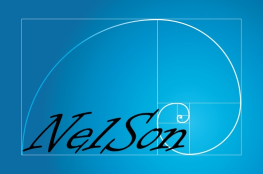

  <a href="https://nelson-lang.github.io/nelson-website/" target="_blank">
    </img>
  </a>

 
 

<table>
  <tr>
    <td>
      
    </td>
    <td>
      
    </td>
    <td>
      
    </td>
  </tr>
</table>

# The Nelson Language

The main homepage for Nelson can be found at [https://nelson-lang.github.io/nelson-website/](https://nelson-lang.github.io/nelson-website/).

## **Starring the repository**

If this project is useful to you, consider [starring it on GitHub](https://github.com/nelson-lang/nelson/stargazers). Repository stars provide a simple signal of usage and help prioritize ongoing maintenance.

## **Introduction**

Nelson is an open-source numerical computing language for engineering, scientific computing, and education. It provides more than 3,000 functions, native or written in Nelson, covering array computation, linear algebra, signal processing, data analysis, visualization, and external language interfaces.

Nelson follows the array-oriented conventions used by established numerical computing environments and GNU Octave, while keeping its own module system, file formats, engine interfaces, and execution model.

## **What's New in Nelson 2.0**

Nelson 2.0 is a major release. Existing scripts run faster, larger projects can use packages and classes, and Nelson runs in a web browser. This release also includes NFlow, a block diagram editor for modeling and simulation.

- Bytecode engine: loops and recursive functions run much faster.
- Object-oriented programming with `classdef`.
- NFlow (1.0.0-beta.1): block diagram editor, simulation, C and Rust code generation, FMI and SSP.
- Web desktop and WebAssembly build (preview): Nelson in a browser, with no installation.
- Debugger in the editor and `.nlx` notebooks.
- `datetime`, `duration`, `table`, `timetable`, `timeseries`, and `categorical`.
- ODE, DAE, DDE, and BVP solvers, optimization, statistics, image processing, and optional GPU computing.
- Python package, built-in MCP server for AI agents, and standalone application compiler.

See the [changelog](CHANGELOG.md) for the full list of changes.

## **Features**

### Language

- Bytecode engine with packages, `import`, nested and local functions, and `arguments` blocks for input validation.
- Object-oriented programming with `classdef` (value and handle classes, inheritance, enumerations, events) and handle objects.
- Anonymous functions, and overloading for all types.

### Data Types

- Double, single, and complex: scalars, vectors, 2-D matrices, N-dimensional arrays, and sparse matrices.
- Logical, and 8, 16, 32, and 64-bit signed and unsigned integers.
- Character and string arrays with full UNICODE support.
- Structures, cells, dictionaries, tables, timetables, time series, and categorical arrays.
- Dates and times: `datetime`, `duration`, and `calendarDuration`.

### Performance

- OpenMP and SIMD parallel processing and vectorization.
- Parallel computing on multi-core processors and MPI for distributed computing.
- Optional GPU computing with `gpuArray` through WebGPU, without CUDA.
- FFT based on FFTW and MKL.

### Scientific Computing

- Linear algebra, signal processing, polynomials, geometry, and special functions.
- ODE, DAE, DDE, and BVP solvers, with an optional SUNDIALS backend.
- Optimization: linear, quadratic, nonlinear, least squares, and problem-based modeling.
- Statistics: distribution fitting, regression, hypothesis tests, clustering, and classification.
- 2-D and 3-D image processing.
- Control system tools and the optional SLICOT interface.

### NFlow (1.0.0-beta.1)

- Block diagram editor for continuous, discrete, and physical (electrical, mechanical, thermal) models.
- Simulation from the editor or from scripts with `sim`, `linmod`, and `trim`.
- C and Rust code generation, FMI 2.0/3.0 and SSP import and export.

### Visualization and Interface

- 2-D and 3-D plotting, including pie, bubble, polar, and box charts, `isosurface`, annotations, and lighting.
- User interface controls and `uifigure` components to build applications.
- Desktop environment with command history, file explorer, workspace browser, variable editor, code editor, and debugger.
- Notebooks (`.nlx`) with code, results, and text.
- Web desktop and WebAssembly build (preview).

### Data Formats and Interfacing

- JSON, XML, HDF5 (default `.nh5` workspace format), MAT-file, and `.xlsx` on every platform.
- Optional NetCDF and Parquet support.
- Foreign Function Interface (FFI): build and load C/Fortran code on the fly.
- MEX C API and Nelson Engine API, plus a C/C++ API to embed Nelson in other applications.
- Julia and Python interfacing, and a Python package to drive Nelson from Python.
- RESTful API, inter-process communication, and QML engine.
- Built-in MCP server for AI agents.

### Developer Tools

- Help engine: HTML, Markdown, PDF, or GitBook output.
- Test engine with HTML, JSON, JUnit XML, and TAP13 reports.
- Profiler and code coverage.
- Code analysis with `checkcode`, `nelson-lint`, and `nelson-lsp`.
- Optional `compiler` module to build standalone applications and installers.

### Extensibility

- Module templates:
  - [Template with Macros and Builtins](https://github.com/nelson-lang/module_skeleton).
  - [Basic Macros Template](https://github.com/nelson-lang/module_skeleton_basic).
- Nelson Modules Manager (`nmm`): package manager with dependency resolution, lockfiles, and publishing.

## **Download**

[Latest Windows Installer](https://github.com/nelson-lang/nelson/releases)

[Get it from the Windows Package Manager](https://winstall.app/apps/NelsonNumericalSoftware.Nelson)

[Get it from the Chocolatey Package Manager](https://community.chocolatey.org/packages/nelson)

[Get it from Scoop](https://scoop.sh/#/apps?q=nelson)

## **Resources**

- **Homepage:** <https://nelson-lang.github.io/nelson-website/>
- **GitBook:** <https://nelson-lang.github.io/nelson-gitbook/>
- **Documentation:** <https://nelson-lang.github.io/nelson-gitbook/releases/en_US/latest/index.html>
- **Debugger Reference:** <https://nelson-lang.github.io/nelson-gitbook/releases/en_US/latest/index.html>
- **Source code:** <https://github.com/nelson-lang/nelson>
- **Binaries:** <https://github.com/nelson-lang/nelson/releases>
- **Docker:** <https://hub.docker.com/r/nelsonsoftware/nelson/>
- **Gitter:** <https://gitter.im/nelson-lang/Lobby>
- **YouTube:** <https://www.youtube.com/channel/UCdZMnH0HC9XflNGAFFiRX9g>
- **Twitter:** <https://twitter.com/Nelson_software>
- **LinkedIn:** <https://www.linkedin.com/groups/13576150>
- **DeepWiki** 

## **License**

Nelson is delivered under dual-license:

- [%20v3.0-blue.svg?style=flat-square>)](https://opensource.org/licenses/LGPL-3.0)

  or

- [%20v3.0-blue.svg?style=flat-square>)](https://opensource.org/licenses/GPL-3.0)

Third-party components redistributed with Nelson are listed in [THIRDPARTY.md](THIRDPARTY.md).

## **Trademarks**

Nelson is an independent free software project, not affiliated with, endorsed by, or sponsored by any third party. See [TRADEMARKS.md](TRADEMARKS.md) for the full notice.

## **Supported Platforms**

Nelson is tested on the platforms listed below. **[Download](https://github.com/nelson-lang/nelson/releases)** options and **[continuous integration (CI)](https://github.com/nelson-lang/nelson/actions/workflows/ccpp.yml)** status are shown for each supported target.

| **Operating System** | **Architecture** |    **CI**    | **Binaries** |
| :------------------: | :--------------: | :----------: | :----------: |
|    Windows 10, 11    |   x86-64 (\*1), arm64   | ✓  |  installer   |
|     macOS 15, 26     |      arm64       | ✓  |     .dmg     |
|     Ubuntu 26.04     |      x86-64      | ✓  |  .deb, Snap, Flatpak  |
|     Ubuntu 26.04     |      arm64       | ✓  |  .deb, Snap, Flatpak  |
|     Ubuntu 24.04     |      x86-64      |    ✓      |     .deb, Flatpak     |
|      Fedora 45       |      x86-64      | ✓  |       Flatpak       |
|      Arch Linux      |      x86-64      | ✓  |   Flatpak          |

The Flatpak package is published on [Flathub](https://flathub.org/apps/io.github.nelson_lang.Nelson).

_Note: The continued support of some platforms may depend on community contributions._

(\*1) On Windows x64, the processor must be an Intel or AMD x86-64 CPU that supports the [AVX2](https://en.wikipedia.org/wiki/Advanced_Vector_Extensions#CPUs_with_AVX2) instruction set.

Official distribution of 32-bit Windows binary versions has been discontinued.

Allan CORNET (nelson.numerical.computation@gmail.com)
